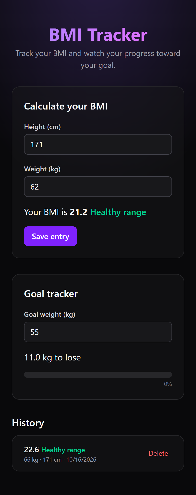

# BMI Tracker + Goal Tracker

A small React app to calculate your BMI live, save entries, and track progress toward a goal weight.

**Live demo:** https://vercel.com/yasmin19/bmi-tracker



## Features

- Live BMI result as you type (no calculate button)
- Save entries to a history list, newest first
- Delete any entry
- Goal tracker with remaining kg and a progress bar
- Accessible: labelled inputs, live regions, named buttons
- Lighthouse accessibility score: 100

## Tech stack

React 19, TypeScript, Vite, Tailwind CSS v4

## Where each piece of state lives (and why)

| State | Lives in | Why |
| --- | --- | --- |
| `heightCm`, `weightKg` (strings) | `BmiForm` | Only the form cares about half-typed input |
| `entries` | `App` | `BmiForm` creates them and `EntryList` and `GoalTracker` display them, so the closest common parent owns them |
| `goalKg` (string) | `GoalTracker` | Only the tracker needs it |

**Derived, not stored:** the BMI result, BMI category, difference to goal, progress percentage and whether the form is valid are all computed during render, so they can never go out of sync.

## What I learned: the keys bug

I deliberately used `key={index}` and added an uncontrolled note input to each row. After typing a note in the top row and deleting it, the note stayed in place while the data changed. React matched rows by position and reused the DOM node. With `key={entry.id}`, React follows the data, so the note is removed together with its entry.

## Run locally

```bash
pnpm install
pnpm dev
```